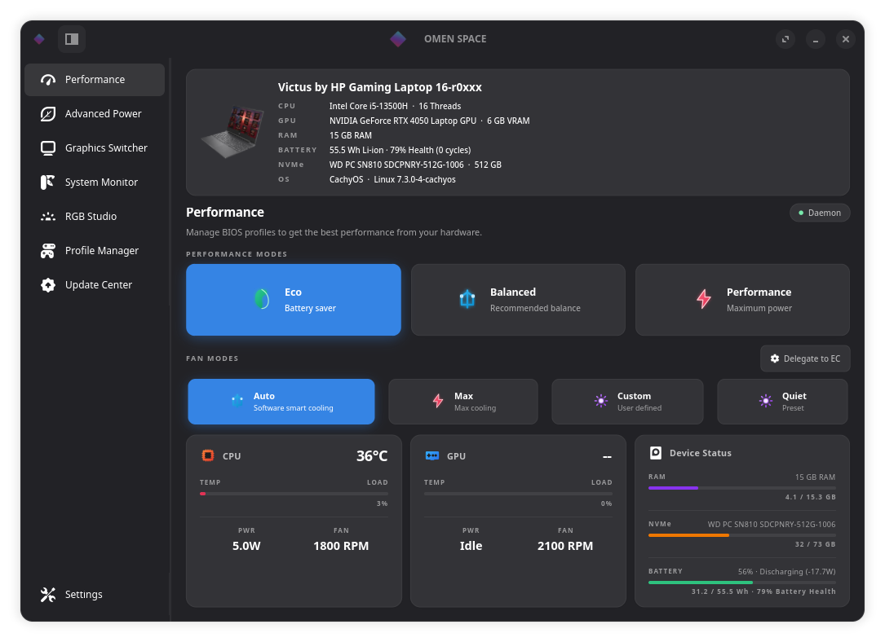
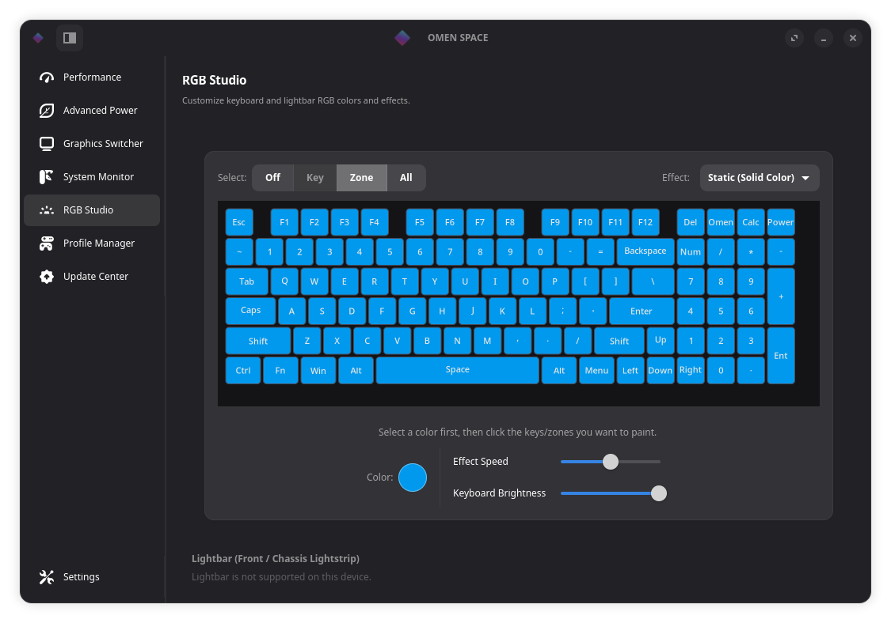
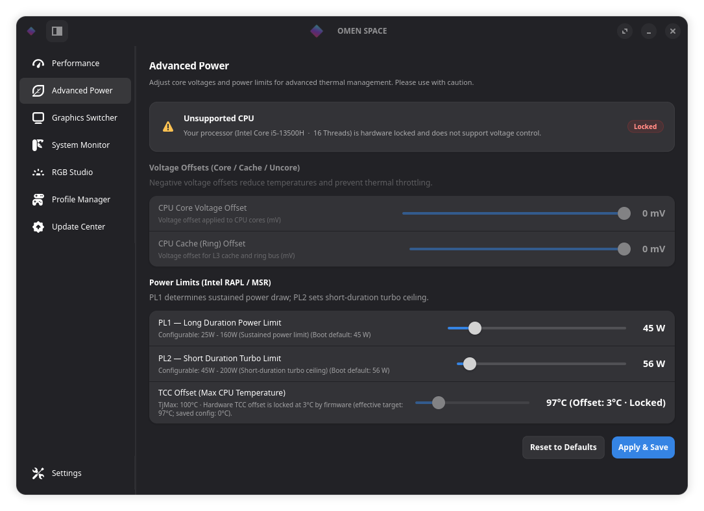
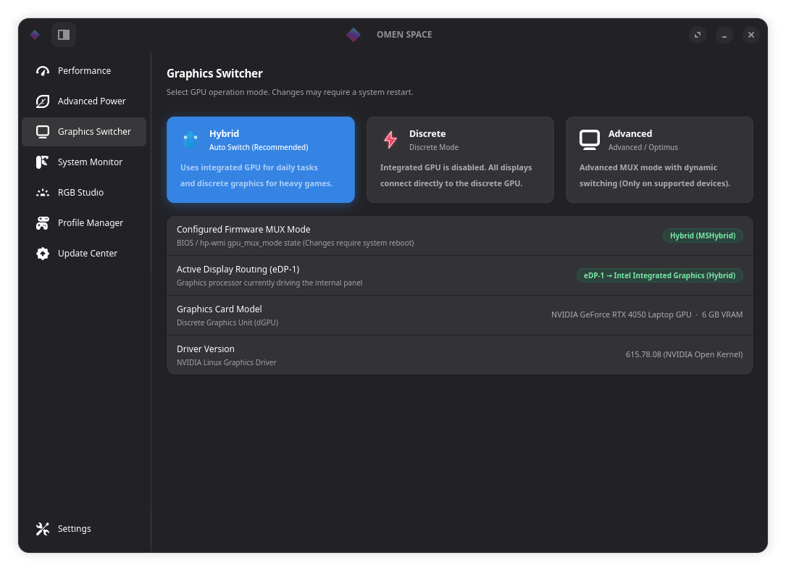
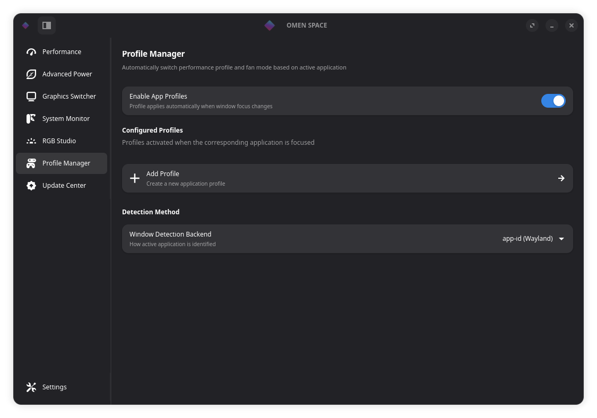
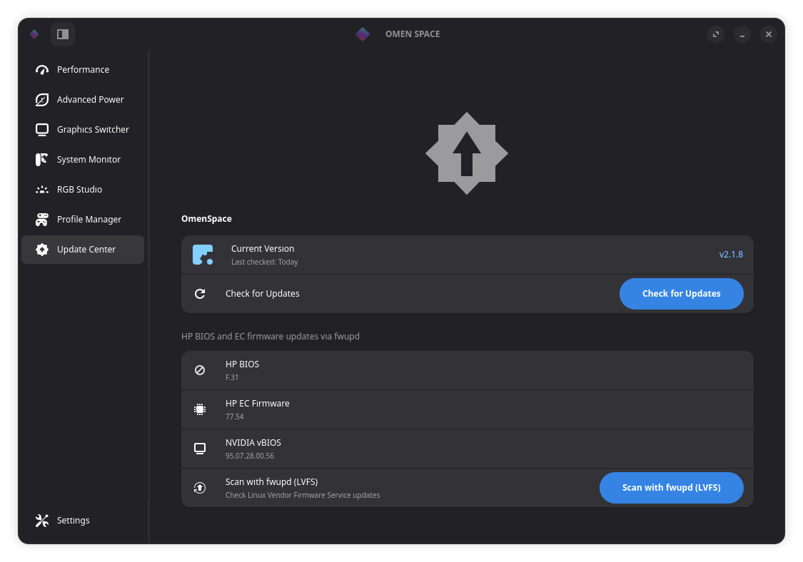

<div align="center">
  

  # OMEN Space

  **Centro de control nativo en Linux para portátiles HP OMEN, Victus y Transcend.**  
  Escrito íntegramente en **Rust** con **GTK4 y Libadwaita** para un rendimiento instantáneo y mínimo consumo.

  <p>
    <a href="https://github.com/yunusemreyl/omen-space/releases/latest">
      
    </a>
    <a href="LICENSE">
      
    </a>
    
    
  </p>

  <p>
    <a href="README.md">English</a> · <b>Español</b>
  </p>

  <br />
  
</div>

---

## Descripción general

**OMEN Space** ofrece control total del hardware en Linux mediante un daemon nativo en Rust (~3 MB) y una interfaz moderna en GTK4 + Libadwaita.

| Módulo | Funciones principales |
| :--- | :--- |
| **Rendimiento y Refrigeración** | Perfiles térmicos `Eco`, `Balanced` y `Performance`; modos de ventilador `Auto`, `Max`, curvas personalizadas con preajustes guardados, delegación directa al **EC**, limpieza de polvo y protección térmica inteligente (`>= 90 °C` / `95 °C`). |
| **Energía Avanzada** | Límites de potencia Intel RAPL `PL1` / `PL2`, límite térmico `TCC Offset`, undervolt por MSR (con detección de `UV_LOCK`), Dynamic Boost de GPU y ajustes para AMD Ryzen SMU. |
| **Selector de Gráficos (MUX)** | Cambio entre **Hybrid (MSHybrid)**, **Discrete (dGPU)** y **Advanced Optimus** con estado de enrutamiento `eDP` y versión del controlador NVIDIA. |
| **RGB Studio** | Iluminación RGB de 4 zonas, zona única (Victus), barra de luz frontal y teclado por tecla Darfon (`0d62:54bf`). |
| **Superposición Rápida (`Shift+F2`)** | Panel flotante dentro del juego y applet de bandeja del sistema sincronizados en tiempo real. |
| **Gestor de Perfiles y Actualizador** | Reglas automáticas por aplicación (Wayland y X11) y **Centro de Actualizaciones** integrado con seguimiento de commits, progreso en vivo y soporte para `fwupd` (LVFS). |

---

## Instalación rápida

```bash
curl -sSL https://raw.githubusercontent.com/yunusemreyl/omen-space/main/install.sh | sudo bash -s -- --stable
```

Para instalar directamente desde la rama `main` (canary):

```bash
curl -sSL https://raw.githubusercontent.com/yunusemreyl/omen-space/main/install.sh | sudo bash -s -- --canary
```

---

## Galería

<p align="center">
  
  
</p>
<p align="center">
  
  
</p>
<p align="center">
  
  
</p>

---

## Licencia

Distribuido bajo la licencia **GPL-3.0**.  
*OMEN Space es un proyecto independiente de código abierto y no está afiliado ni respaldado por HP Inc.*
